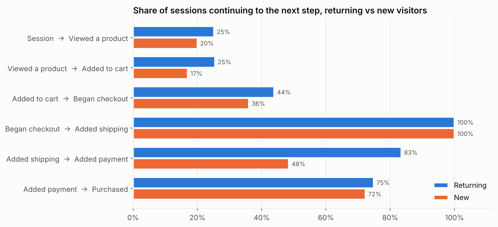
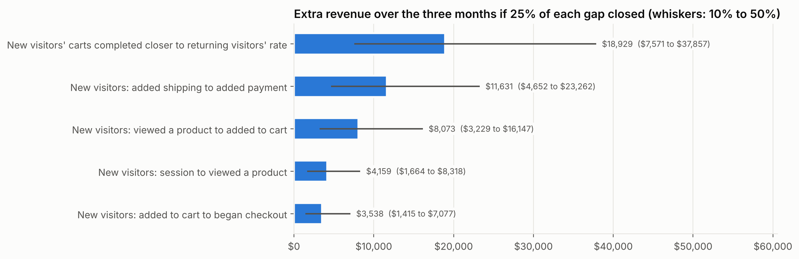
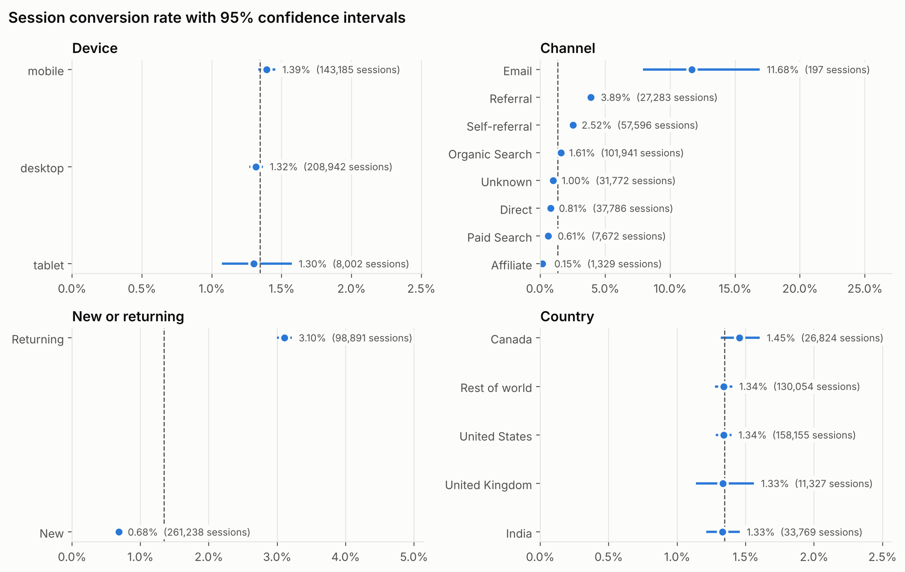

# Customer Revenue & Conversion Analytics Platform

Where is the Google Merchandise Store losing revenue across traffic, conversion, products and customers, and what would a realistic improvement be worth?

This project answers that from Google's public GA4 e-commerce sample: 4.3 million events from November 2020 to January 2021, modelled in BigQuery with dbt, tested with statistical methods in Python, and presented in Tableau Public. The answer is not a device problem. It is first-time visitors stalling at the payment step of checkout.



## Key findings

Over the 92 days: 360,129 sessions, 4,451 orders and $307,640 of revenue, a 1.35% session conversion rate and a $69 average order. Differences below are significant at the 5% level after adjusting for multiple comparisons unless stated.

1. **New visitors are where revenue is lost, not mobile users.** Mobile converted at 1.39% and desktop at 1.32%, a difference that is not significant, and no checkout step differed by device. Returning visitors converted at 3.10% against 0.68% for new visitors. Returning visitors were 27% of sessions but brought 67% of revenue.
2. **The payment step is the largest single gap.** Of new visitors who entered shipping details, 48% went on to enter payment details, against 83% of returning visitors (95% CI for the gap: 33 to 37 points). Once payment was entered, new and returning visitors completed the purchase at similar rates (72% and 75%, not significant). New visitors also trailed at every earlier step: viewing a product (20% vs 25%), adding to cart (17% vs 25%) and starting checkout (36% vs 44%).
3. **Most sessions never reach a product.** 79% of sessions did not view a product, and 81% of sessions that added to cart did not buy in that session.
4. **Paid search looks weak per session but not per customer.** Per session it converted at 0.61% against 1.61% for organic search. Judged by the visitors each channel first brought, 1.27% of paid search's visitors bought within the period against 1.31% of organic search's, a difference within the margin of error. Paid search starts journeys that finish on later visits.
5. **A third of revenue was credited to the store's own domain.** Self-referrals, where a visit restarts on the store's own site (often on return from checkout), made up 16% of sessions and 33% of revenue. Another 26% of sessions had no recorded source, and only one of them included a purchase. Channel reports built on the raw data overstate referral traffic and understate every other channel.
6. **Apparel carries the store.** Apparel brought 58% of item revenue, led by hoodies and sweatshirts in the winter season. The top 36 of 390 products brought half of item revenue.
7. **Revenue follows the holidays.** Conversion was 1.59% in December and 0.94% in January; monthly revenue fell from $158,136 to $56,510.
8. **Repeat buyers are few but valuable.** 11.9% of buyers ordered more than once and brought 24.8% of revenue. Returning visitors' orders averaged $72 against $65 for new visitors.



**What closing the gap would be worth.** If new visitors' carts converted to purchases 25% closer to returning visitors' rate, the store would have earned about **$18,900 more over the three months** (6% of revenue), with a range of $7,600 to $37,900 for 10% to 50% of the gap. The payment step alone accounts for about $11,600 ($4,700 to $23,300). Each estimate uses the segment's own revenue per conversion; the assumptions are listed in the [notebook](notebooks/conversion_analysis.ipynb). The estimates overlap, so they are alternatives, not a total.

## Recommendations

1. **Make it easier for first-time buyers to pay.** Guest checkout, express wallets and fewer payment fields address the step where new visitors fall furthest behind. Test the change before rolling it out: detecting an improvement from 48% to 57% (25% of the gap) needs 511 new visitors reaching shipping in each variant, about four weeks at this period's traffic.
2. **Fix tracking before trusting channel reports.** List the store's own domains as unwanted referrals in GA4 and find out why a quarter of sessions carry no source. Until then, any budget decision based on channel conversion is working from distorted numbers.
3. **Judge paid search on the customers it brings, not the sessions.** On per-session numbers it would be the first channel cut, but its visitors become buyers as often as organic search's.
4. **Give new visitors a reason to come back.** Returning visitors convert at more than four times the rate of new ones. Email sessions converted at 11.7%, though from only 197 sessions (95% CI 7.9% to 16.9%), so capturing an email address on a first visit is a candidate worth testing.
5. **Fix product tracking.** View and add-to-cart events in this data carry long lists of products (about 36 and 44 per session), so product pages cannot be evaluated until those events record the product actually viewed or added.



## Dashboard

A Tableau Public dashboard built on the exported marts is in progress.

## Data and limitations

- **Source:** [Google Analytics 4 sample e-commerce dataset](https://developers.google.com/analytics/bigquery/web-ecommerce-demo-dataset) for the Google Merchandise Store, read in place from `bigquery-public-data`. Google obfuscates parts of it, including about a quarter of first-touch sources.
- **Orders:** a transaction ID sometimes appears on several purchase events; it is counted once. Purchases with no usable transaction ID (8.8% of raw purchase revenue) and repeated events (6.3%) are excluded from revenue. A daily reconciliation test checks that the three parts add back to raw purchase revenue.
- **Funnel:** GA4 does not force steps into order, so the funnel is closed: a session counts at a step only if it completed every earlier step in that session. 41% of sessions with a purchase skipped a step in that session, so the closed funnel ends below total purchases.
- **Products:** analysed from purchases only, for the reason in recommendation 5. Raw category labels differ between event types and are mapped to merchandise groups.
- **Three months, including the holidays.** There is too little history for lifetime value or cohort retention, and annualising the dollar estimates would overstate them.
- **No costs.** The data has no ad spend or margins, so the estimates are revenue, not profit.

## How it works

```
bigquery-public-data GA4 sample (92 daily tables)
        |
dbt staging: stg_events, partitioned by day, incremental, 4.3M rows
        |
dbt intermediate: int_sessions (funnel flags, channels), int_orders (de-duplicated),
                  int_purchase_reconciliation
        |
dbt marts: fct_daily_sessions, fct_product_daily, dim_customers, fct_purchase_reconciliation
        |                                                   20 dbt tests
export_marts.py -> data/exports/*.csv
        |                         |
conversion_analysis.ipynb     Tableau Public
(SciPy, statsmodels)
```

- **Staging** reads only the daily source tables a run needs, keeps 23 columns, and on incremental runs reprocesses the last three days, replacing those partitions with BigQuery copy jobs instead of a MERGE.
- **Intermediate** models build one row per session with closed-funnel flags and channel, and one row per de-duplicated order.
- **Marts** store additive counts only (sessions, sessions reaching each step, orders, revenue), so any rate in Tableau is computed correctly for any filter.
- **Tests** cover keys, allowed values, a staging-to-source row count match, daily revenue reconciliation, mart-to-orders reconciliation, funnel ordering and one category per product.
- **Statistics:** Wilson 95% intervals for rates, two-proportion z-tests with Holm adjustment for differences, bootstrap intervals and Mann-Whitney tests for order values, and a power calculation for the recommended A/B test. Helpers are in [`analysis/conversion_stats.py`](analysis/conversion_stats.py).

### BigQuery cost

| December conversion by device, read from | MB billed | Cheaper than raw |
|---|---:|---:|
| Raw events, filtered on the date column | 1,083 | 1x |
| Raw events, only December's daily tables | 398 | 2.7x |
| Partitioned staging table | 102 | 10.6x |
| Mart | 10 (BigQuery's minimum) | 108x |

An incremental run billed 112 MB for the staging table against 2,146 MB for a full build. Clustering did not help: at about 14 MB a day, each partition is a single storage block, so there is nothing to skip. Everything in the project, including setup, used less than 30 GB of BigQuery's free monthly terabyte. Details in [cost results](docs/cost_results.md).

## Documentation
- [Business case, scope and KPI definitions](docs/business_case.md)
- [Data model and definitions](docs/data_model.md)
- [Source data profile](docs/data_profile.md)
- [BigQuery cost results](docs/cost_results.md)
- [Analysis notebook](notebooks/conversion_analysis.ipynb), with results in [`data/exports/analysis/`](data/exports/analysis/)

## Stack
BigQuery, dbt, Python (pandas, SciPy, statsmodels, matplotlib), Tableau Public.

## Run locally
The notebook runs from the committed CSVs in `data/exports/` with no Google Cloud account:
```
python -m venv .venv && source .venv/bin/activate
pip install -r requirements.txt
jupyter nbconvert --to notebook --execute --inplace notebooks/conversion_analysis.ipynb
```
To rebuild everything from BigQuery, you need the [Google Cloud CLI](https://cloud.google.com/sdk/docs/install) and a project with billing enabled (the BigQuery sandbox deletes partitions older than 60 days, which empties tables built on 2020 data):
```
gcloud auth application-default login
cp .env.example .env                      # then set GCP_PROJECT
set -a; source .env; set +a
python analysis/profile_source.py         # source profile and baseline scan sizes
cd dbt && dbt build --profiles-dir . && cd ..
python analysis/measure_cost.py           # bytes saved by the model design
python analysis/export_marts.py           # marts to data/exports/
```
